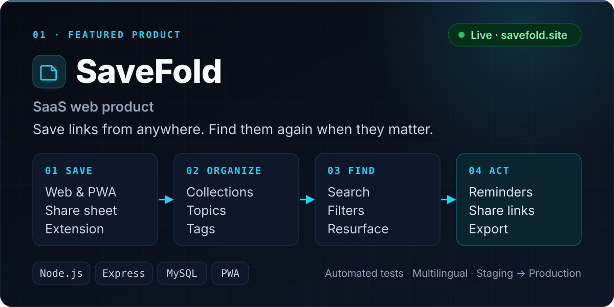
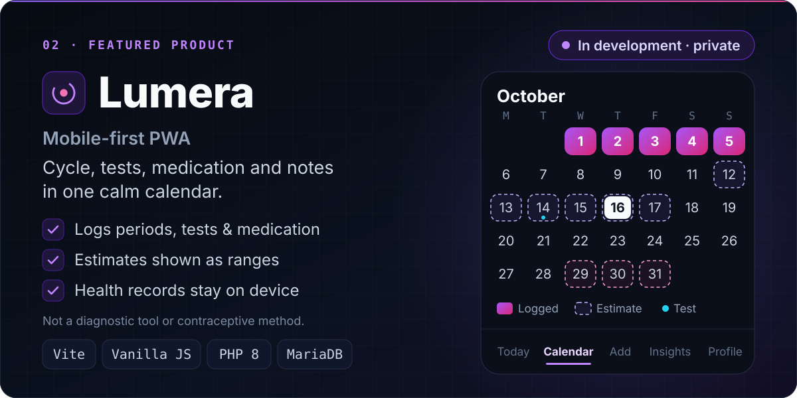
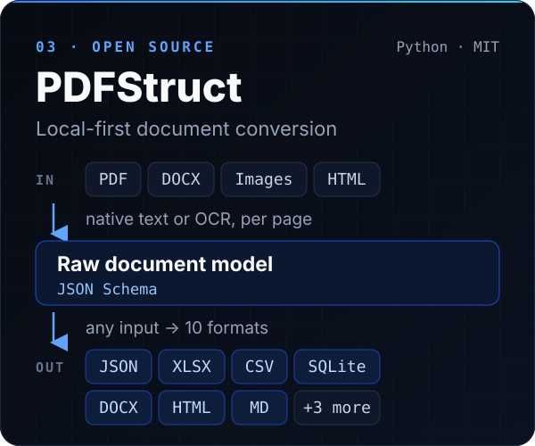
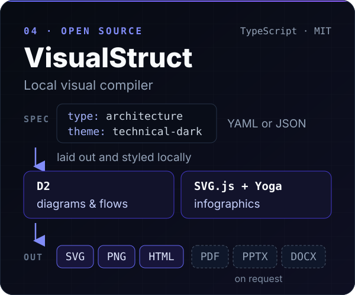
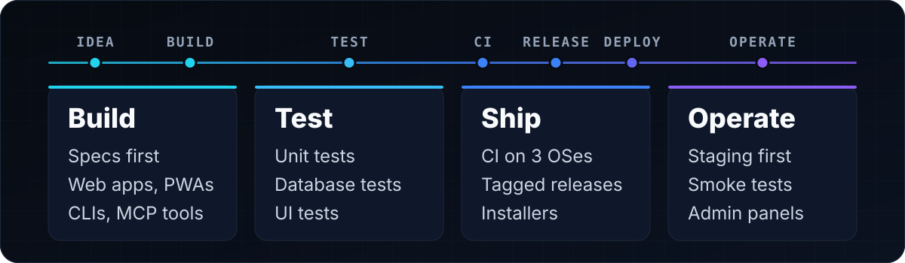

  

  <a href="https://mustafakelesoglu.de/en/"><b>Portfolio</b></a>
  &nbsp;·&nbsp;
  <a href="https://mustafakelesoglu.de/en/projects"><b>Projects</b></a>
  &nbsp;·&nbsp;
  <a href="mailto:info@mustafakelesoglu.de"><b>info@mustafakelesoglu.de</b></a>

## Featured work

  

[**SaveFold** · savefold.site](https://savefold.site) · private repository

  

[**Lumera** · case study](https://mustafakelesoglu.de/en/projects/gevher) · private repository

  
  

## What I build

| Area | Where it shows |
| --- | --- |
| **SaaS & web products** | SaveFold: accounts, payments integration, admin panel |
| **Consumer PWAs** | Lumera: installable, three languages, printable doctor summary |
| **Developer tools** | PDFStruct and VisualStruct: CLIs, desktop GUI, Windows installers |
| **AI-assisted workflows** | MCP servers and Claude / ChatGPT plugins that let assistants run local tools |

## Engineering approach

  

## Technology

| Area | Used in my projects |
| --- | --- |
| **Languages** | TypeScript · JavaScript · Python · PHP |
| **Backend** | Node.js · Express · EJS · PHP 8 APIs |
| **Frontend** | PWAs (service worker, web manifest, share target) · Vite · vanilla JS / CSS |
| **Data** | MySQL / MariaDB · SQL migrations · JSON Schema |
| **Testing** | node:test · supertest · pytest · Vitest · Playwright |
| **Delivery** | GitHub Actions · Dependabot · PyInstaller · staged deploys |
| **Tooling** | MCP · PySide6 · D2 · PaddleOCR |

## Open source

| Project | Ships as | Status |
| --- | --- | --- |
| [**PDFStruct**](https://github.com/KelesogluMustafa/pdfstruct) | CLI · desktop GUI · MCP server · Claude plugin · Windows builds |   |
| [**VisualStruct**](https://github.com/KelesogluMustafa/visualstruct) | CLI · MCP server · Claude & ChatGPT plugins · Windows setup |   |

 

  

  <a href="https://mustafakelesoglu.de/en/"><b>Portfolio →</b></a>
  &nbsp;·&nbsp;
  <a href="https://github.com/KelesogluMustafa?tab=repositories"><b>Repositories →</b></a>
  &nbsp;·&nbsp;
  <a href="mailto:info@mustafakelesoglu.de"><b>Email →</b></a>

